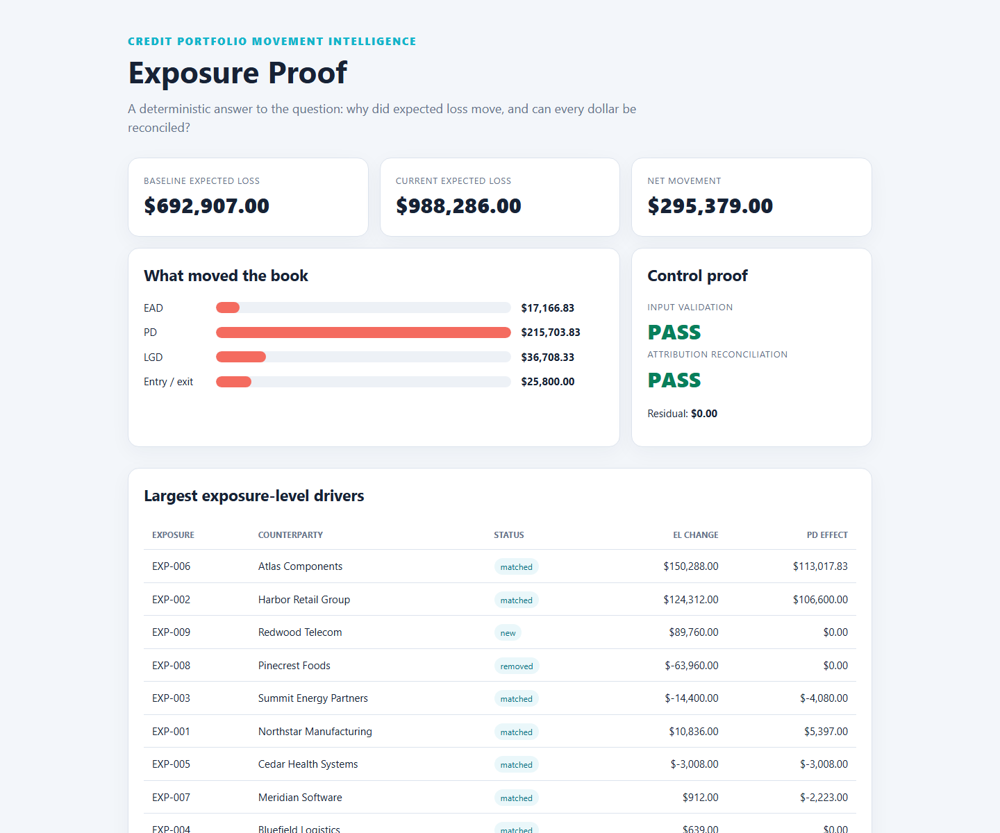

# Exposure Proof

**Explain every dollar of expected-loss movement. Prove the answer reconciles.**

[](https://github.com/Karthikvk1899/exposure-proof/actions/workflows/ci.yml)
[](https://www.python.org/)
[](LICENSE)
[](pyproject.toml)

Credit portfolio reports usually show that risk moved. Exposure Proof answers the harder questions:

- Was the change driven by exposure, probability of default, loss severity, or portfolio churn?
- Which counterparties explain the movement?
- Do the exposure-level drivers reconcile exactly to the portfolio total?
- Can another reviewer reproduce the result from the same files?

It compares two CSV snapshots, validates them, calculates expected loss, performs an
order-independent Shapley decomposition across EAD/PD/LGD, and emits a review-ready evidence pack.
The engine is local, deterministic, and has no runtime dependencies.



> **Scope:** This is a portfolio movement and control tool—not a credit scoring model,
> regulatory capital calculator, or lending decision system. The included data is synthetic.

## Thirty-second demo

```bash
git clone https://github.com/Karthikvk1899/exposure-proof.git
cd exposure-proof
python -m pip install -e .
exposure-proof compare examples/baseline.csv examples/current.csv --out artifacts
```

```text
Evidence pack: .../artifacts
Expected-loss delta: 295379.00000
Unexplained residual: 0E-22
```

Open `artifacts/report.html` for the executive view. The same run creates:

| Artifact | Audience | Purpose |
|---|---|---|
| `report.html` | Risk manager / recruiter | Visual movement narrative and control result |
| `report.md` | Analyst / pull request reviewer | Portable, diff-friendly review |
| `evidence.json` | Engineer / auditor | Machine-readable detail, hashes, and all exposure attributions |

## Why this is different

Most portfolio projects stop at a dashboard or predict default. Exposure Proof treats the
explanation itself as a controlled data product.

```text
baseline.csv ──┐
               ├─► fail-closed validation ─► exact EL calculation
current.csv  ──┘                                  │
                                                 ▼
                              order-independent change attribution
                                                 │
                         ┌───────────────────────┼─────────────────────┐
                         ▼                       ▼                     ▼
                   executive HTML        Markdown review       JSON evidence
                   + control status      + top drivers         + SHA-256 lineage
```

### Exact change attribution

For a matched exposure, expected loss is:

```text
EL = EAD × PD × LGD
```

Changing all three inputs creates interaction effects. A simple waterfall depends on the order in
which the analyst swaps inputs. Exposure Proof evaluates all `3! = 6` update orders and averages
each factor's marginal contribution. The result is an order-independent Shapley attribution:

```text
ΔEL = EAD effect + PD effect + LGD effect
```

New and removed exposures are reported as a separate entry/exit effect. Across the entire book:

```text
portfolio ΔEL = Σ factor effects + Σ entry/exit effects + unexplained residual
```

The run fails the reconciliation control if the residual is not exactly zero. All monetary math uses
`Decimal`, not binary floating point; non-terminating representation residue is closed
deterministically below report precision (see [methodology](docs/METHODOLOGY.md)).

## Input contract

CSV files need one row per exposure and these columns:

| Column | Meaning | Control |
|---|---|---|
| `exposure_id` | Stable key across snapshots | Required, nonblank, unique |
| `counterparty` | Display name | Required, nonblank |
| `sector` | Concentration dimension | Required, nonblank |
| `country` | Concentration dimension | Required, nonblank |
| `rating` | Internal or external grade | Required, nonblank |
| `ead` | Exposure at default | Numeric, `>= 0` |
| `pd` | Probability of default | Numeric, `0..1` |
| `lgd` | Loss given default | Numeric, `0..1` |

The validator fails closed on duplicate keys, missing fields, invalid ranges, or empty files.

## Evidence model

Every evidence pack includes:

- full SHA-256 hashes for both inputs;
- an evidence ID derived from those hashes;
- baseline and current portfolio totals;
- EAD, PD, LGD, and entry/exit effects;
- the unexplained residual and control status;
- sector and country concentration with HHI;
- rating migrations;
- top drivers and every exposure-level attribution.

This makes a result traceable without uploading portfolio data or relying on a notebook's hidden state.

## Development

```bash
python -m pip install -e ".[dev]"
ruff check .
pytest
```

CI runs on Python 3.10–3.12 and executes the example portfolio as an end-to-end reconciliation test.

## Roadmap

- configurable materiality thresholds and policy-as-code gates;
- multi-currency normalization with explicit FX attribution;
- scenario packs for sector and country stress;
- Parquet and DuckDB adapters for larger books;
- signed evidence manifests and longitudinal trend comparison.

## Responsible use

Do not commit confidential portfolio data. Use synthetic or approved de-identified data in issues,
demos, and pull requests. Results are analytical aids and require review under the policies,
methodology, and governance applicable to the institution using them.

## License

[MIT](LICENSE) © 2026 Karthik Beesa
